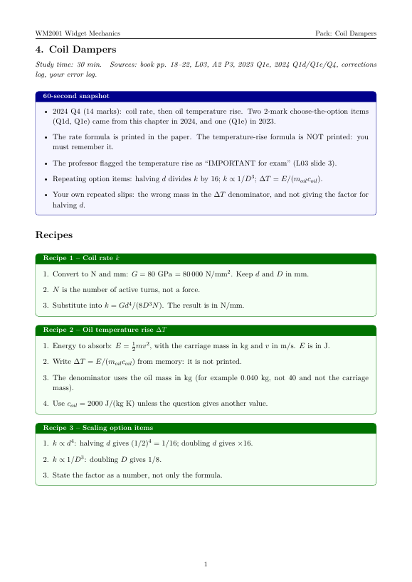
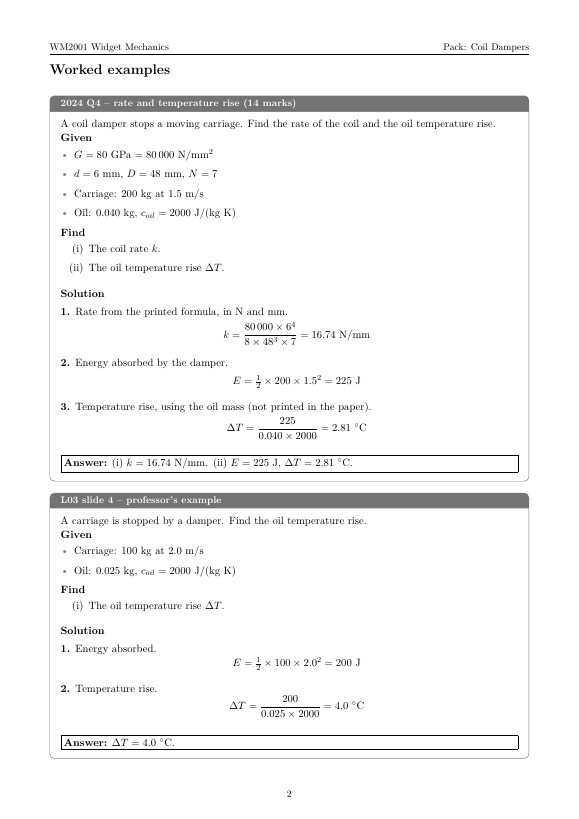
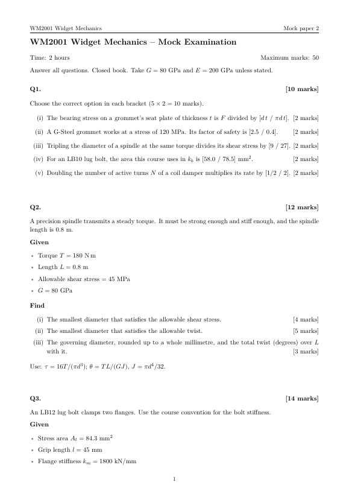

# tminus

**Exam in 2-3 days and a lot left to cover?** `tminus` is a Claude Code plugin that turns your own course folder
(textbook PDF, lecture slides, assignments, past papers) into a study sprint:

- a **triage plan**: chapters ranked by expected marks per study minute, a cut line for the hours you actually
  have, and a day-by-day schedule with spaced review, a timed mock and a cram block;
- **compact chapter packs** (30-45 min each): what gets asked, step-by-step recipes in *your professor's* method,
  worked examples, formulas marked *given* (printed on the paper) or *remember*, common traps;
- **active-recall drills** in the terminal that log your mistakes and feed them back into the plan;
- a **mock paper** in your examiner's style with a verified answer key;
- a **night-before cram pack**.

Every number in the output is recomputed in Python. Every place where the book, the slides or a printed answer is
wrong is flagged with the correction and how it was checked.

---

## See what it produces

Sample outputs from the synthetic test course *WM2001 Widget Mechanics* (made-up subject, no real course material).
Click a page to open the full PDF.

<table>
  <tr>
    <td align="center"><a href="examples/samples/pack-coil-dampers.pdf"></a><br><b>Chapter pack</b><br>snapshot, recipes</td>
    <td align="center"><a href="examples/samples/pack-coil-dampers.pdf"></a><br><b>Worked examples</b><br>given / find / step by step</td>
    <td align="center"><a href="examples/samples/mock-paper.pdf"></a><br><b>Mock paper</b><br>(<a href="examples/samples/mock-answer-key.pdf">answer key</a>)</td>
  </tr>
</table>

Also: the [cram pack](examples/samples/cram-pack.pdf), the [triage ranking](examples/samples/triage.md) and the
[day-by-day plan](examples/samples/plan.md). In the pack, note the professor's convention box and the flagged book
error (the book prints 73 &deg;C; the pack recomputes 7.3 &deg;C).

---

## Contents
1. [Requirements](#1-requirements)
2. [Install](#2-install)
3. [First run](#3-first-run)
4. [Prepare your course folder](#4-prepare-your-course-folder)
5. [The sprint, step by step](#5-the-sprint-step-by-step)
6. [Command reference](#6-command-reference)
7. [Using it effectively](#7-using-it-effectively)
8. [Which subjects it suits](#8-which-subjects-it-suits)
9. [What gets written where](#9-what-gets-written-where)
10. [Time and cost](#10-time-and-cost)
11. [Troubleshooting](#11-troubleshooting)
12. [How it stays correct](#12-how-it-stays-correct)
13. [Copyright, privacy, development](#13-copyright-privacy-development)

---

## 1. Requirements

You need **Claude Code** (CLI, desktop app or IDE extension) and:

| Tool | Needed for | |
|---|---|---|
| Python >= 3.9 with PyYAML | everything | required |
| PyMuPDF *or* `pdftotext` (poppler) | reading PDFs | required |
| `latexmk` + `pdflatex` (TeX Live) *or* `tectonic` | PDF output | optional: without it you get Markdown |
| `pdftoppm` or PyMuPDF | cropping figures | optional |
| `tesseract` | reading scanned PDFs (OCR) | optional |
| Pint | unit-aware number checks | optional |

You don't have to check any of this by hand: `/tminus:doctor` (step 3) does it and prints the exact install
command for your OS (Arch, Debian/Ubuntu, Fedora, macOS, WSL). Native Windows: use WSL2.

Python packages go into the plugin's own virtualenv (`~/.cache/tminus/venv`). Nothing is installed globally,
and nothing that needs `sudo` is ever run for you.

---

## 2. Install

Pick one.

### A. From GitHub (recommended)
Inside Claude Code:
```
/plugin marketplace add spandan11106/tminus
/plugin install tminus@tminus-marketplace
```
Or from a shell:
```bash
claude plugin marketplace add spandan11106/tminus
claude plugin install tminus@tminus-marketplace
```


### B. From a local clone (permanent install)
```bash
git clone https://github.com/spandan11106/tminus.git ~/tminus
claude plugin marketplace add ~/tminus
claude plugin install tminus@tminus-marketplace
```

### C. Try it for one session, without installing
```bash
claude --plugin-dir ~/tminus
```

### Check it worked
```bash
claude --plugin-dir ~/tminus plugin details tminus     # for option C
```
or, in a session, type `/tminus:` and the commands should autocomplete: `doctor`, `setup`, `triage`, `pack`,
`drill`, `formulas`, `mock`, `cram`.

---

## 3. First run

Open Claude Code **inside your course folder** and run:
```
/tminus:doctor
```
You get a table of OK / MISSING / WARN items and a fix command for each gap.

- **Python packages missing?** Run `/tminus:doctor --install`. It shows what it will install into the plugin venv
  and asks once before doing it.
- **System tools missing (TeX, poppler, tesseract)?** Doctor prints the command; run it yourself, for example by
  typing `! sudo pacman -S ...` in the prompt. It never runs `sudo` for you.
- **No LaTeX and you don't want it?** Say yes when doctor offers Markdown mode. Every command still works and
  writes `.md` files instead of PDFs.

---

## 4. Prepare your course folder

One folder per course, holding your own files. Subfolders and names are up to you, but clear names help setup
classify files faster:

```
EE3005/
├── book/Chapman.pdf          # the textbook (a text PDF beats a scan)
├── slides/Lec_01.pdf ...     # lecture slides from your professor
├── assignments/A1.pdf ...    # assignments, tutorials, problem sets (with solutions if you have them)
└── papers/Endsem_2025.pdf    # past papers: the most valuable input of all
```

Worth knowing:
- **Past papers drive the ranking.** Add every paper you can find (end-sems, mid-sems, quizzes) and any answer
  keys. With no papers, triage falls back to lecture emphasis and your self-ratings.
- **Your professor's slides beat the book.** Include all of them, since setup reads them to find where the
  professor's method or notation differs from the textbook.
- **Scanned PDFs** work if `tesseract` is installed (OCR is done page by page, only where needed). If a text
  copy of the same document exists, keep it in the folder too.
- Duplicate copies are fine; setup notices them.

---

## 5. The sprint, step by step

### Day 0 (about 15 minutes of your attention)

**1. `/tminus:setup`**: classifies every file, finds the book's page offset (PDF page vs printed page), maps
lectures, assignments and past-paper questions to chapters, and checks that each paper's marks add up. Then it
asks you one batch of questions:

| Question | How to answer well |
|---|---|
| Exam date and time | the real one, so the hours left are right |
| Study hours per day | be honest; a plan you can keep beats an ambitious one |
| Open or closed book, what is printed on the paper | decides which formulas are *given* and which to *remember* |
| Self-rating 1-5 per chapter | 1 = never seen it, 5 = could teach it; this sets how much time each chapter gets |
| Where does your professor differ from the book, what did they stress? | the most important answer. Anything said in class ("always use the stress area", "this will come") goes here |

Check the short list of **low-confidence mappings** it shows you, and correct any that are wrong.

**2. `/tminus:triage`**: writes the ranking, the cut line and a day-by-day plan to `sprint/`. Read the one-line
reason for each chapter. If you disagree, say so and it changes the weights or your rating and re-runs.

### Each study day
Follow `sprint/plan.md`. A typical day looks like:
```
/tminus:triage                  # morning: re-plan from yesterday's drill results (seconds)
/tminus:pack 6                  # read the pack: 30-45 min
/tminus:drill 6                 # straight after: 20-30 min of active recall
/tminus:pack 2
/tminus:drill 2
/tminus:drill mixed             # from day 2: short mixed sessions across chapters
```
The plan also schedules a short **spaced review** of the previous day's chapters each morning.

### Last full day
```
/tminus:formulas                # two-column formula sheet + one-page must-remember sheet
/tminus:mock                    # a timed paper in your examiner's style; write answers on paper
/tminus:drill                   # paste your mock answers to get them graded against the key
/tminus:cram                    # evening: the night-before pack
```

### Exam morning
Skim pages 1-2 of the cram pack (formulas and one-liners) for 20-30 minutes. No new material.

---

## 6. Command reference

| Command | What it does | Arguments |
|---|---|---|
| `/tminus:doctor` | checks tools, prints fix commands, sets Markdown mode if you have no LaTeX | `--install` installs Python packages into the plugin venv (asks first) |
| `/tminus:setup` | builds `course.md` from your folder and your answers | `--refresh` after new lectures or papers arrive: updates mappings and conventions, and lists every answer in existing packs that changes |
| `/tminus:triage` | ranking, cut line, day-by-day plan; re-run daily | none |
| `/tminus:pack` | compact chapter pack + seeds the drill deck | chapter id(s), or `tier-A`; `--rebuild` only recompiles an existing pack |
| `/tminus:drill` | interactive active-recall session | a chapter id, `weak` or `mixed`; `--minutes N` (default 25) |
| `/tminus:formulas` | formula sheet + one-page must-remember sheet | chapter ids or `all` (default: tiers A-C) |
| `/tminus:mock` | timed mock paper + answer key, independently verified | `--minutes N` (default: real paper duration) |
| `/tminus:cram` | night-before pack (no new material) | none |

---

## 7. Using it effectively

**Drill more than you read.** Packs are short on purpose. Self-testing works much better than rereading, so
the plan gives drills more time than packs. Do the drill straight after each pack.

**Answer before you look.** In a drill, type your answer even if you are unsure. The session never shows the
answer first unless you type `skip`.

**Be honest about how sure you were.** If you got it right but guessed or were slow, say so: the item is marked
*hesitant* and comes back the next day. Wrong items come back later in the same session and the next day.

**Numericals are taught, not quizzed.** For each question type you see a worked example, then a half-done
problem to finish, then a full problem with new numbers. Ask for a hint any time. Feedback checks your *method*
first (right formula, your professor's convention, units), then the numbers.

**Re-run `/tminus:triage` every morning.** It reads your drill accuracy: chapters you struggle with move up,
chapters you have nailed move down, and it tells you what moved and why.

**Read `progress/errors.md`.** It groups the mistakes you keep making ("used carriage mass instead of oil mass
x3"). The cram pack lists your top ten on the last night.

**Tell it when the professor does something differently.** Mid-sprint, run `/tminus:setup --refresh` or just say
so. Conventions in `course.md` override the book everywhere, and packs that change are listed for regeneration.

**Confirm corrections.** When a tool finds an error in the book or slides, it goes to
`progress/corrections_candidates.md`. Only you move it into the verified log in `course.md`.

**Disagree with the plan when you know better.** Rankings are heuristics from past papers. Edit your
self-ratings in `course.md`, or ask triage to change a weight (`sprint/weights.json`). See `docs/TRIAGE.md`.

**Short on time?** Generate packs only for tier A (`/tminus:pack tier-A`), drill `weak`, and skip tier X
chapters without guilt: triage tells you what the cut costs in expected marks.

**Use the mock properly.** Set a real timer, write on paper, closed book. Then paste your answers into
`/tminus:drill` for grading. The key's path is only shown after you say you have finished.

---

## 8. Which subjects it suits

tminus was built and tested on **numerical and mixed subjects**: Design of Machine Elements (long numericals plus
one-liners) and Electrical Machines (a multiple-choice end-sem with numerical options).

| Subject type | Support today |
|---|---|
| Numerical / problem-solving (design, machines, mechanics, circuits) | **Full.** Recipes, worked examples, the worked-example drill loop, recomputed answer keys. |
| Mixed (numericals + one-liners / MCQs) | **Full.** Tested on a real course. |
| Theory-heavy with short answers (definitions, one-liners, MCQ, true/false) | **Good.** Triage, retrieval drills, the one-liners page of the cram pack and MCQ mocks all work. |
| Theory-heavy with long answers ("explain", "discuss", 10-mark essays, derivations) | **Partial.** See below. |

What works for theory-heavy subjects now:
- `setup` and `triage` are subject-agnostic: ranking comes from past-paper marks and your self-ratings.
- `drill` in retrieval mode is the strongest part for theory: one-liners, fill in the blanks, true/false and short
  answers, asked first and graded after you answer, with wrong and unsure items coming back.
- `cram` puts the most likely one-liners and your weak items on one page.

Known gaps for long-answer theory papers:
1. **Packs** are built around recipes and worked numericals. Theory chapters need *answer skeletons* instead:
   the points examiners reward, in order, key terms, the diagram to draw, one example.
2. **Drill grading** handles short items (correct / partial / hesitant / wrong). A 10-mark answer needs a point-wise
   marking scheme that tells you which points you missed and logs them to `errors.md`.
3. **Verification** is strictest for numbers; descriptive prose is only spot-checked. For theory subjects every
   definition and claim should be checked against the source.
4. **`formulas`** has no theory counterpart yet (a key terms, definitions and models sheet).
5. **Diagrams drawn from memory** (supply-demand curves, the Solow growth curve, block diagrams) cannot be graded in
   a terminal; grading a photo of a handwritten answer is a v0.2 candidate.

**Planned: theory mode.** A per-chapter switch, set by `setup` from the chapter's `kind`, giving answer-skeleton packs,
long-answer drills graded against marking schemes, full claim-checking of prose, a key-terms sheet, and long-answer
mock questions with point-wise marking. It will be tested on a real theory-heavy course before release. Until then,
for long-answer papers use `pack` for the overview, drill the definitions and one-liners, and paste a written answer
into `/tminus:drill` and ask it to mark it against the source.

---

## 9. What gets written where

Everything stays inside your course folder:

```
course.md                      # the course profile: chapters, papers, conventions, corrections log (editable)
sprint/triage.md, plan.md      # ranking + day-by-day plan (triage.json, signals.json, weights.json for tools)
packs/<id>.pdf (.tex / .md)    # chapter packs (old version kept as <id>.prev.tex when regenerated)
outputs/formulas.pdf           # formula sheet
outputs/must_remember.pdf      # one-page must-remember sheet
mock/mock-1.pdf, mock-1-key.pdf
cram/cram.pdf
progress/attempts.jsonl        # every drill answer
progress/errors.md             # mistakes you keep making
progress/weakmap.md            # chapters ranked weakest first
progress/deck/<id>.json        # drill questions per chapter
progress/corrections_candidates.md
.tminus/                       # caches, number-check files, page previews
```

---

## 10. Time and cost

Measured on a real course (EE3005 Electrical Machines, 115 documents) and a synthetic test course, with Sonnet:

| Step | Wall time | Approx. cost |
|---|---|---|
| doctor | ~10 s | $0.10 |
| setup | 1-4 min | $0.30-1.40 |
| triage | ~20 s | $0.15 |
| pack (one chapter) | 1-4 min | $0.30-1.00 |
| drill session | interactive | ~$0.25 |
| formulas | 1.5-3 min | $0.40-0.65 |
| mock | 2-6 min | $0.50-1.30 |
| cram | 1.5-2.5 min | $0.40-0.65 |

A full 3-day sprint on a five-chapter course is roughly $5-10. Generating only tier A saves the most.

---

## 11. Troubleshooting

| Symptom | Fix |
|---|---|
| "no course.md" | run `/tminus:setup` in the course folder; tminus always works in the folder you started Claude in |
| validator errors in course.md | the message names the row and field; past-paper cells look like `2024 Q2b (6); 2024 Q1(iv) (1)` |
| PDF build fails: ASCII gate | a non-ASCII character slipped in; the message gives line, column and the LaTeX replacement |
| PDF build fails: overfull gate | a line or table is too wide; the pack command fixes and rebuilds it, or rebuild with `/tminus:pack <id> --rebuild` |
| no LaTeX, don't want it | `/tminus:doctor`, accept Markdown mode (`format: md` in course.md) |
| "image-only, needs OCR" | install tesseract (doctor prints the command) or add a text copy of the file |
| triage cuts a chapter you need | lower its self-rating, or ask triage to change a weight; long book chapters can be costed by the pages actually taught (edit the page range in course.md) |
| a midsem is weighted like an end-sem | in course.md front matter: `papers: {Mid25: {year: 2025, weight: 0.5, partial: true}}` |
| permission prompts | the commands pre-approve only the plugin's own `tm` script; other tools ask as usual |

---

## 12. How it stays correct

- **Your professor wins.** `course.md` holds a professor-conventions section; every command follows it over
  the book and says which source it used.
- **Recompute rule.** Every number goes through `scripts/recompute.py` (safe expression evaluation, optional
  units). Book errors become flags in the output and candidate corrections for you to confirm.
- **Source rule.** Formulas, limits, table values and printed answers are checked against the cited page.
  Anything unchecked is marked `[UNVERIFIED]`, never stated as fact.
- **Figure rule.** Figures are cropped and viewed before use; values read off charts are marked *approx.*
- **Independent verifier.** Mock papers and multi-chapter outputs are re-checked by a separate subagent that
  sees the sources but not the draft's reasoning.
- Each output ends with a **verification report**: checked, matched, flagged, unverifiable.

On the synthetic test course, setup and the packs caught every planted textbook error (a reversed limit, a
decimal slip, a wrong printed answer) and used the slide's method where it contradicted the book.

---

## 13. Copyright, privacy, development

**Copyright.** This repository contains no textbooks, slides or past papers, and never should. You supply your
own files; everything generated stays in your course folder. Do not commit course material if you fork this.
Test fixtures are synthetic (`tests/fixtures/make_toycourse.py`).

**Privacy.** Your files are read by Claude Code the same way as in any session. The plugin does not upload
anything elsewhere; the only network access is `pip` when you run
`/tminus:doctor --install`.

**Development.**
```bash
python3 -m venv .venv && .venv/bin/pip install -r requirements-dev.txt
scripts/selftest.sh             # unit tests, preflight simulation, template builds, plugin validation
scripts/selftest.sh --no-tex    # the same with LaTeX hidden (Markdown mode)
claude plugin validate .
```
Design notes: `docs/PLAN.md` (spec), `docs/DECISIONS.md` (deviations and why), `docs/BUILD_LOG.md` (what was
tested and fixed), `docs/TRIAGE.md` (ranking formulas). Shared LaTeX style: `templates/tminus.sty`; tunable
per-command instructions: `templates/briefs/`.

MIT licence.
